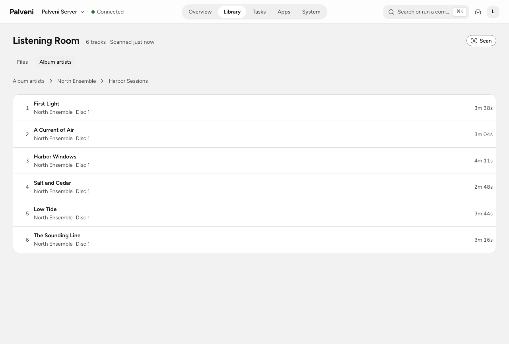
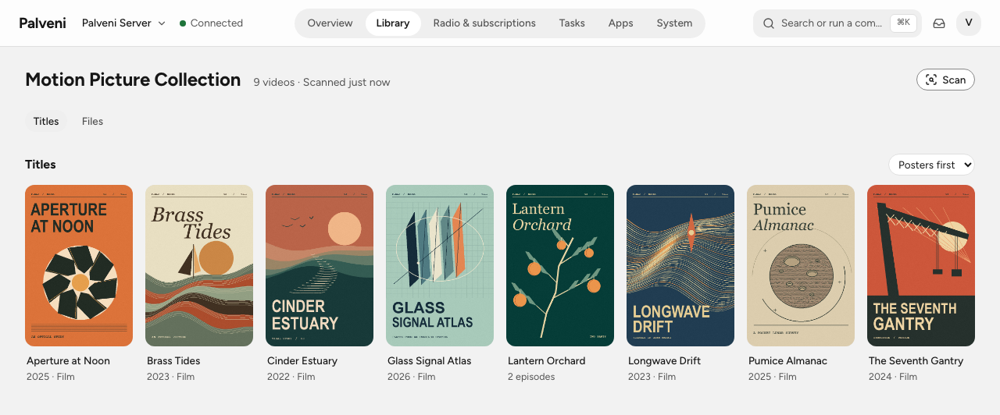

# Palveni Server

Palveni is a self-hosted media server for music, films, TV, audiobooks and podcasts. Its web dashboard lets you browse your library, play original files, listen to radio and open live TV channels. SQLite is the default database. PostgreSQL and MySQL are also supported.

## Run with Docker

Build the image from the repository root. Replace `/path/to/media` with a directory containing your own media.

```sh
docker build -f packaging/docker/Dockerfile -t palveni-server .
docker run -d --name palveni \
  -p 127.0.0.1:7258:7258 \
  -v palveni-data:/data \
  -v /path/to/media:/media:ro \
  palveni-server
```

Open the [dashboard](http://localhost:7258) and create an administrator account. Under **System → Libraries**, add `/media` and start a scan. The data volume stores accounts, the media index, device keys and installed skins. For a LAN deployment or hardware acceleration, see the [Compose example](packaging/docker/compose.yaml).

If a previously populated source becomes empty or loses most of its files, its missing entries stay in the library. Open the library as an administrator, choose **Review missing files**, and inspect the paths before confirming. The server checks the source again before removing entries from the index.

## Build from source

Install Node.js 24 and the [pinned Rust toolchain](rust-toolchain.toml). Install FFmpeg and FFprobe for media diagnostics. The Docker image includes both tools. At startup, Palveni checks each encoder with a short test clip and limits the threads used by each probe.

```sh
npm ci --prefix web
npm run build --prefix web
cargo build --locked --manifest-path packaging/smb-helper/Cargo.toml --target-dir target
cargo run --locked -p palveni-server --features embed-web -- serve
```

Run `palveni doctor` to check FFmpeg, hardware acceleration and database connectivity. The running server publishes its OpenAPI specification at `/api/v1/openapi.json`. Use `palveni openapi` to export it offline.

## Browse a music library

Choose **Music** when adding a library, then scan its folders. Open the library and choose **Album artists** to browse albums and tracks. Compilation albums stay together under their album artist. Tracks without tags appear under an unknown artist or album and use their filenames as titles. Run a scan after upgrading to index music that is already in your library.

To search across music libraries, open the dashboard search box with ⌘K or Ctrl+K, enter an artist, album or track, and choose the music search action. Each result shows its library. Chinese names also match simplified and traditional characters, pinyin and initials.

To use an OpenSubsonic player, open **System → Settings → Account → OpenSubsonic music clients** and create a password. Enter the server’s base address, your username and this password in the player. The music catalog supports browsing, searching and streaming original files with seeking. Allow personal music access when creating the password to sync favorite artists, albums and tracks, song ratings, playlists and listening history. Compatible players can also display synced or plain lyrics. All players on your account share the password. You can replace or revoke it in Settings. Use HTTPS when connecting over the internet.

Open an album to play its tracks. **Libraries** brings together your continue-playing list, history and favorites. Administrators can rename a library or add folders under **System → Libraries**. Existing items keep their identities and playback history.

After the first scan, Palveni watches each library for file additions, edits, renames and deletions. It groups bursts of activity into one scan and updates open library views when the scan finishes. Libraries are also checked on startup and every 15 minutes, including network mounts that do not deliver filesystem notifications. Renaming a track gives it a new item ID. Favorites, playback progress and playlist entries stay associated with the old ID.

Clients can play a scanned track in its original format through the native API. Send an authenticated `GET /api/v1/items/{id}/stream` to read the file or seek with an HTTP byte range. For a player that opens URLs, send an authenticated `POST /api/v1/items/{id}/playback` and resolve the returned `url` against the server address. The link is valid for 15 minutes and can be renewed for later seeks.

If the browser cannot decode an original track, the web player requests a compatible audio format. Native clients can request MP3, AAC or Opus at 32–320 kbit/s and resume at a time offset. Audio transcoding requires FFmpeg and the Lite, Standard or Performance tier.

To split a continuous recording into tracks, place a UTF-8 CUE sheet beside the audio it references and scan the music library. The album view shows the individual tracks. You can play, seek and favorite each one. The original recording remains available in the file view. Playing a CUE track requires FFmpeg and at least the Lite tier.

Administrators can choose **Analyze loudness** in a music library. After the job finishes, expand **Loudness analysis** in the track player or open the track’s file details to see its integrated loudness (LUFS), loudness range (LU) and true peak (dBTP), where measurable. You can stop the job and run it again to continue. Analysis reads the audio without changing it.

Clients can request lyrics with an authenticated `GET /api/v1/items/{id}/lyrics`. Place a matching `.lrc`, `.LRC` or `.lyrics.txt` beside a track to override its embedded lyrics. Edits are available on the next request, and timed lyrics keep their original timestamps.

Signed-in clients can favorite and rate tracks and videos, browse recently played items, and continue from the position saved on another device. Each account has its own history and ordered music playlists. The native API exposes these features under `/api/v1/me/items` and `/api/v1/me/playlists`. Playback updates and playlist edits use a version so one device can detect changes made on another. To display a playlist, use `GET /api/v1/me/playlists/{id}/tracks?version=N` to load titles, artists, albums and durations in order.

<picture>
  <source media="(prefers-color-scheme: dark)" srcset="docs/images/music-library-dark.png">
  
</picture>

## Films, TV and spoken audio

Add a **Video** library and scan its folders to browse a poster wall. Search titles across the library or filter for films or series. Films and series with artwork appear first. Choose **By title** to see the whole collection in title order. A film in its own folder can use `movie.nfo` for its title and year and `poster.jpg` for artwork. Series open into seasons and episodes. The file view is also available. Scan an existing video library once after upgrading to pick up its artwork.

Choose **Audiobooks** or **Podcasts** for a folder of spoken audio. The dashboard groups the files into books or shows. Each file is a chapter or episode, and each listener can return to the position they last played.

<picture>
  <source media="(prefers-color-scheme: dark)" srcset="docs/images/video-library-dark.png">
  
</picture>

## Network sources and subscriptions

To index media on a NAS, mount its share on the host and expose it read-only to the container. Choose that directory when adding a library. For on-demand browsing, open **Network sources** and add an SMB3 or WebDAV directory, or connect a Jellyfin, Emby or Plex server using its access token. Members can browse and play from a connection. Palveni encrypts the saved credentials with the installation's node key. For a binary installation, place `palveni-smb-helper` beside `palveni`. The Docker image includes both.

Open **Radio & subscriptions** to add a radio or live TV playlist (M3U or grouped text), an XMLTV guide, or an RSS or Atom podcast feed. Channels can have multiple streams. Listeners can switch streams, see what's on now and next, and keep their own favorites. Browser playback depends on the media format.

## Skins and plugins

Open **Apps → Plugin store** to search available and installed plugins. Install an official skin or upload a community skin as a tar archive, then select it in **Appearance**. Palveni validates the archive before applying it. Find official packages and contribution guidelines in the [plugins repository](https://github.com/palveni-labs/plugins).

## License

The server and dashboard use the [Mozilla Public License 2.0](LICENSE). Plugin interfaces in `wit/` use the [Apache License 2.0](wit/LICENSE). Bundled fonts retain their respective licenses.
